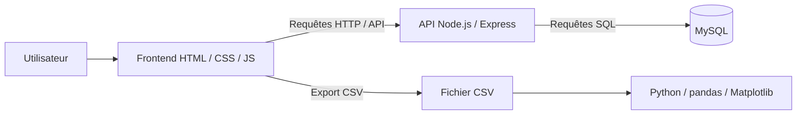
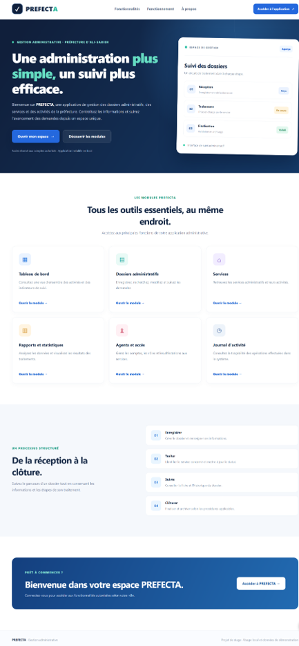
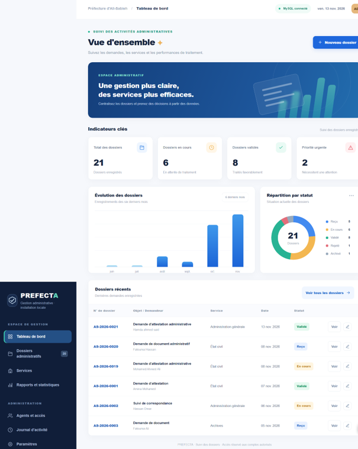
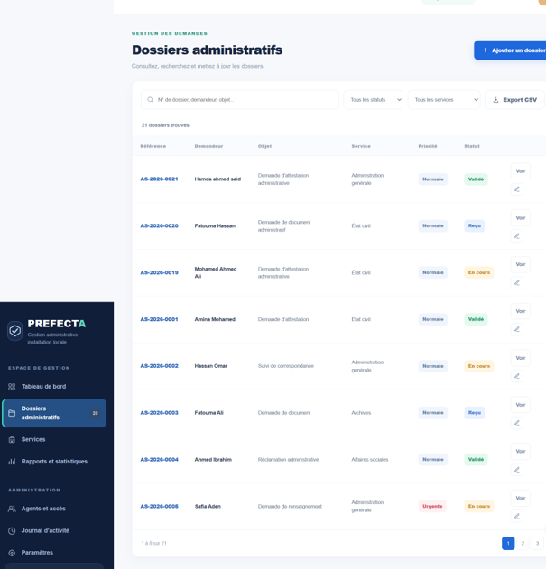
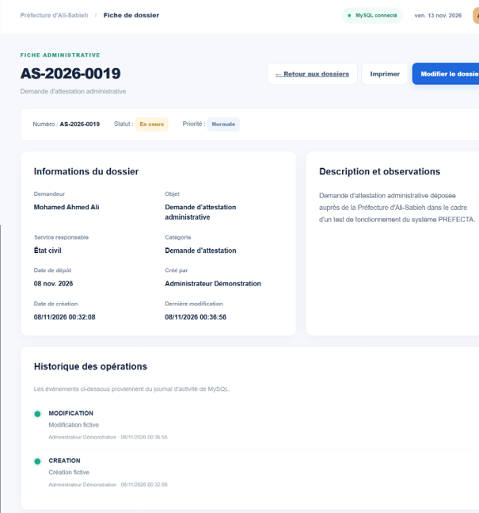
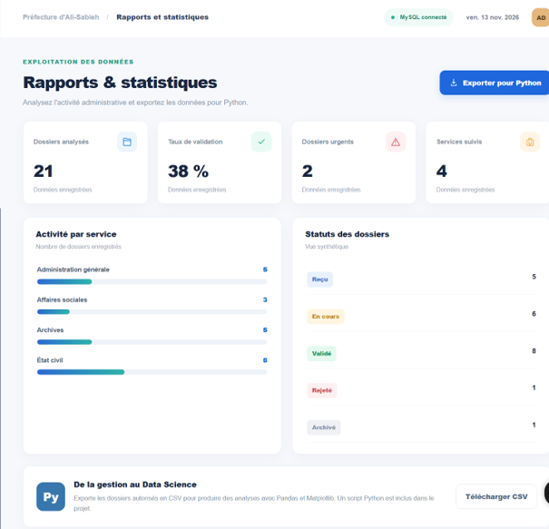

<div align="center">

# 🏛️ PREFECTA
### Gestion et analyse statistique des activités administratives

**Une application Full Stack pour organiser les dossiers, les services et le suivi des activités administratives de la Préfecture d’Ali-Sabieh (Djibouti).**


**Projet académique / de stage — démonstration non officielle, non déployée en production.**

</div>

---

## 📌 Présentation

**PREFECTA** est une application web de gestion administrative conçue pour centraliser le suivi des demandes et faciliter l’analyse des activités d’une préfecture.

Le projet associe une interface web multipages, une API REST en **Node.js / Express**, une base **MySQL** et un module d’analyse statistique **Python**. L’objectif est de proposer un outil cohérent pour l’enregistrement, le traitement et la consultation des dossiers, avec des autorisations adaptées aux utilisateurs.

### Objectifs

- Centraliser les dossiers administratifs dans une base de données structurée.
- Faciliter la recherche, la modification et le suivi des demandes.
- Organiser les utilisateurs et les services administratifs.
- Produire des indicateurs de suivi et des exports exploitables.
- Conserver une trace des opérations effectuées dans l’application.

> **Important :** PREFECTA est un projet de développement et de démonstration. Il ne constitue pas un service officiel de la Préfecture d’Ali-Sabieh. L’utilisation de données administratives réelles exige une autorisation explicite et une validation de sécurité et de conformité.

## ✨ Fonctionnalités

| Module | Fonctions disponibles dans le projet |
| --- | --- |
| 🏠 **Accueil** | Présentation de l’application et accès aux modules (page d’accueil ajoutée au projet local). |
| 🔐 **Authentification** | Connexion par compte, sessions JWT et changement de mot de passe. |
| 📁 **Dossiers administratifs** | Enregistrement, consultation, recherche, modification, statuts et priorités. |
| 🗂️ **Fiche dossier** | Consultation des informations d’un dossier et de son historique ; impression depuis le navigateur. |
| 🏢 **Services** | Consultation, création, modification et activation/désactivation selon les autorisations. |
| 👥 **Agents et accès** | Comptes utilisateurs, rôles, affectations aux services et gestion des accès. |
| 📊 **Tableau de bord** | Vue synthétique des dossiers et de leur répartition. |
| 📈 **Rapports** | Indicateurs, graphiques et export CSV pour les analyses Python. |
| 🕘 **Journal d’activité** | Consultation des opérations enregistrées par l’application. |
| ⚙️ **Paramètres** | Informations de l’environnement et changement de mot de passe. |

**Rôles applicatifs :** `Administrateur`, `Agent` et `Lecteur`. Les autorisations sont contrôlées par le backend ; un agent ne doit accéder qu’aux dossiers de son service affecté.

## 🛠️ Technologies utilisées

| Couche | Technologies |
| --- | --- |
| Interface | HTML5, CSS3, JavaScript, Vite |
| API REST | Node.js, Express |
| Authentification | JWT, bcryptjs |
| Base de données | MySQL, mysql2 |
| Analyses | Python, pandas, Matplotlib |
| Développement local | Visual Studio Code, WAMP64, Git, GitHub |
| Mesures techniques | Helmet, limitation des tentatives de connexion, validations côté serveur |

## 🏗️ Architecture



### Organisation des fichiers

```text
PREFECTA/
├── analytics/
│   └── analyse.py
├── backend/
│   ├── config/
│   ├── controllers/
│   ├── middlewares/
│   ├── routes/
│   ├── scripts/
│   ├── tests/
│   ├── utils/
│   ├── app.js
│   ├── server.js
│   └── package.json
├── database/
│   └── schema.sql
├── frontend/
│   ├── public/
│   ├── src/
│   │   ├── assets/
│   │   ├── css/
│   │   │   ├── accueil.css
│   │   │   └── style.css
│   │   ├── js/
│   │   └── pages/
│   │       ├── tableau-de-bord.html
│   │       ├── dossiers.html
│   │       ├── dossier-detail.html
│   │       ├── services.html
│   │       ├── agents.html
│   │       ├── rapports.html
│   │       ├── journal.html
│   │       └── parametres.html
│   ├── index.html
│   ├── package.json
│   └── vite.config.js
├── .gitignore
└── README.md
```

> Les dossiers `node_modules/`, `frontend/dist/` et les fichiers `.env` sont exclus du dépôt. Le schéma des fichiers reflète la version locale avec les mises à jour « Fiche dossier » et « Accueil » ; publiez également ces modifications pour que GitHub corresponde à cette structure.

## 🚀 Installation et exécution en local

### Prérequis

- **Node.js** et **npm** installés ;
- **MySQL** disponible (par exemple via WAMP64) ;
- **Git** pour récupérer le code ;
- **Python 3**, uniquement pour l’analyse statistique.

### 1. Récupérer le projet

```powershell
git clone https://github.com/hamdaahmedsaid1-wq/PREFECTA.git
cd PREFECTA
```

> Le dépôt est **privé** : le clonage nécessite un compte GitHub autorisé.

### 2. Préparer MySQL et la configuration

Démarrer MySQL, puis créer le fichier **`backend/.env`** sur votre machine. Exemple de configuration **sans secrets réels** :

```dotenv
PORT=3000
DB_HOST=127.0.0.1
DB_PORT=3306
DB_USER=root
DB_PASSWORD=
DB_NAME=prefecta_ali_sabieh
JWT_SECRET=REMPLACER_PAR_UNE_LONGUE_CLE_ALEATOIRE_PRIVEE
SEED_ADMIN_EMAIL=administrateur@exemple.local
SEED_ADMIN_PASSWORD="REMPLACER_PAR_UN_MOT_DE_PASSE_PRIVE"
```

Utiliser un mot de passe administrateur d’au moins **12 caractères** et un `JWT_SECRET` aléatoire d’au moins **48 caractères**. Pour générer une clé :

```powershell
node -e "console.log(require('crypto').randomBytes(48).toString('hex'))"
```

**Ne jamais publier `backend/.env`, la clé JWT ni les mots de passe.**

**Nouvelle installation uniquement :** importer `database/schema.sql` via phpMyAdmin, puis exécuter dans `backend/` :

```powershell
npm install
npm run migrate
npm run seed
npm run doctor
```

**Base existante :** effectuer d’abord une sauvegarde, **ne pas réimporter** `schema.sql` et **ne pas relancer** `seed`. Le script `migrate` doit être utilisé uniquement après vérification de la version du schéma et sauvegarde.

### 3. Démarrer le backend

Dans un premier terminal :

```powershell
cd backend
npm install
npm run doctor
npm start
```

API locale : **http://127.0.0.1:3000**  
Vérification : **http://127.0.0.1:3000/api/health**

### 4. Démarrer le frontend

Dans un second terminal, à partir de la racine `PREFECTA` :

```powershell
cd frontend
npm install
npm run dev
```

Ouvrir **http://127.0.0.1:5173/**. Vite redirige les requêtes `/api` vers le serveur Express sur le port 3000.

### 5. Compilation du frontend (optionnelle)

```powershell
cd frontend
npm run build
```

Après compilation, le backend peut servir les fichiers produits dans `frontend/dist/`. L’exécution sur Internet nécessite une configuration et des contrôles supplémentaires ; cette compilation ne constitue pas un déploiement sécurisé.

## 📊 Analyse statistique avec Python

Depuis la page **Rapports et statistiques**, exporter les dossiers autorisés au format CSV, puis installer les dépendances :

```powershell
python -m pip install pandas matplotlib
```

Lancer ensuite l’analyse en fournissant le chemin du fichier exporté :

```powershell
python analytics/analyse.py "chemin/vers/export_dossiers.csv"
```

Le script affiche notamment la répartition par **statut** et par **service**, le **taux de validation**, le nombre de dossiers **urgents** et génère un graphique mensuel `rapport_prefecta.png` à côté du CSV.

## 🧪 Vérifications et tests

Depuis `backend/` :

```powershell
npm run doctor
npm run verify-auth
npm run check
npm test
```

Une exécution locale du **13 novembre 2026** a donné **26 tests réussis sur 26**, couvrant notamment les règles d’accès aux dossiers, les routes de consultation d’une fiche et la présence des pages du frontend. Ces tests ne remplacent pas des tests d’intégration complets ni un audit de sécurité.

## 📸 Captures d'écran de PREFECTA

Découvrez les principales interfaces de PREFECTA, une application Full Stack de gestion et d'analyse statistique des activités administratives.

---

### 🏠 1. Page d'accueil

La page d'accueil présente l'application PREFECTA, ses objectifs et les principales fonctionnalités disponibles.



---

### 📊 2. Tableau de bord

Le tableau de bord permet de visualiser les activités administratives, les indicateurs de performance et les statistiques des dossiers enregistrés.



---

### 📁 3. Gestion des dossiers administratifs

Ce module permet aux utilisateurs autorisés d'enregistrer, de rechercher, de consulter et de modifier les dossiers administratifs.



---

### 📝 4. Fiche détaillée d'un dossier

Chaque dossier administratif possède une fiche détaillée présentant ses informations, son statut, sa priorité et son historique.



---

### 📈 5. Rapports et statistiques

Le module de rapports permet d'analyser les activités administratives grâce à des indicateurs, des graphiques et des exports de données.



---

## 🔐 Sécurité et confidentialité

- Les mots de passe sont stockés sous forme de **hash bcrypt**.
- Les API métier nécessitent une **authentification JWT** et appliquent des restrictions selon les rôles et les services.
- Les mots de passe et clés privées sont placés dans un **fichier `.env` non versionné**.
- Les demandes de connexion sont soumises à une limitation du nombre de tentatives.
- Les opérations importantes sont inscrites dans un journal d’activité.

**Limites actuelles :** application développée pour un usage local et une démonstration. Avant toute utilisation institutionnelle, prévoir notamment un audit de sécurité, HTTPS, des sauvegardes et restaurations testées, la gestion des habilitations et une évaluation des obligations de protection des données.

## 🗺️ Évolutions envisagées

- [ ] Workflow complet d’affectation, de traitement et de clôture des dossiers.
- [ ] Exports PDF/Excel enrichis et rapports périodiques.
- [ ] Tests d’intégration avec une base de test dédiée.
- [ ] Journalisation, supervision et sauvegardes automatisées.
- [ ] Accessibilité et ergonomie renforcées.
- [ ] Déploiement sécurisé après validation institutionnelle.

## 👤 Projet et contact

Projet développé dans une démarche **académique et de stage**, autour de la **gestion administrative** et de l’**analyse de données**.

**Dépôt GitHub :** [hamdaahmedsaid1-wq/PREFECTA](https://github.com/hamdaahmedsaid1-wq/PREFECTA)  
**Contexte :** Préfecture d’Ali-Sabieh, Djibouti — projet non officiel.

---

<div align="center">
  <strong>PREFECTA</strong> — Centraliser • Suivre • Analyser
</div>
